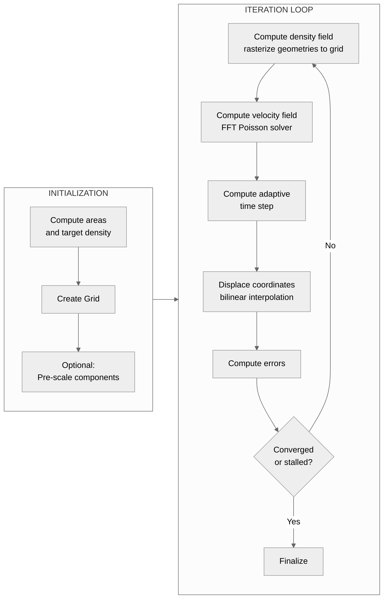

# Flow Cartogram Algorithm

## Overview

The flow cartogram algorithm deforms polygon geometries so that each region's area becomes proportional to an associated data value while maintaining spatial contiguity and approximate shape recognition. The approach follows Gastner and Newman's diffusion-based density-equalizing map method \[1\]: high-density regions expand and low-density regions contract until all regions reach a uniform equilibrium density.

The algorithm is implemented in `morph_geometries()` ([algorithm.py](https://github.com/bright-fakl/carto-flow/blob/main/src/carto_flow/flow_cartogram/algorithm.py)). The high-level API is `CartogramWorkflow` ([workflow.py](https://github.com/bright-fakl/carto-flow/blob/main/src/carto_flow/flow_cartogram/workflow.py)).

### Intuition

Think of the value of a region as people who spread out evenly over the area they live on. A region with many people on a small area is dense: its people push outward, and the region grows. A sparse region gives way and shrinks. The flow carries the borders until the density is the same everywhere, which is the same as every area being proportional to its value.


## Mathematical Foundation

### Equilibrium Condition

Given $n$ regions with data values $v_1, \ldots, v_n$ and current areas $a_1, \ldots, a_n$, the target is for every region to have the same density:

$$
\rho^* = \frac{\sum_i v_i}{\sum_i a_i}
$$

At convergence, each region has area:

$$
a_i^{\text{final}} = \frac{v_i}{\rho^*}
$$

### Error Metric

Area error is measured in log₂ space:

$$
e_i = \log_2\!\left(\frac{a_i^{\text{current}}}{a_i^{\text{target}}}\right)
$$

This representation is symmetric: $e_i = +1$ means the region is twice as large as its target; $e_i = -1$ means half as large. The equivalent percentage error is:

$$
e_i^{\%} = \operatorname{sign}(e_i) \cdot \left(2^{|e_i|} - 1\right) \cdot 100
$$

Both areas are first raised to a floor $\varepsilon = \texttt{error\_floor} \cdot \overline{a^{\text{target}}}$ (default $10^{-3}$ of the mean target area), so that a collapsed or zero-valued region has a finite error. The floor does not depend on the grid, which makes the reported errors comparable between grid sizes and between the levels of a multiresolution morph; regions with a target below the floor count as on target while their area stays below it. `error_floor=0` disables it.

**Self-intersecting output.** The vertices move independently, so a region that is much narrower than a grid cell somewhere (a thin neck) can be pinched until its boundary crosses itself; less often a thin wedge of a neighboring region is squeezed between two parts of its boundary. Adjacent regions share vertices (identical coordinates), so the invalid regions are mostly on shared borders. The morph warns and `Cartogram.invalid_regions` lists the regions. The computed geometries keep the vertices of the input, which animations between cartograms (keyframes) need, so they are not repaired by default. `Cartogram.get_geometry(repair=True)` and `Cartogram.to_geodataframe(repair=True)` make the invalid regions valid (`shapely.make_valid`, zero-area parts dropped); a region can become a MultiPolygon, its area changes slightly, its vertices no longer correspond to the input, and the vertex added to one region is not added to its neighbor. Do not repair geometries that are animated between cartograms.

---

## Computational Pipeline



### Initialization

1. Compute initial polygon areas and target density $\rho^*$.
2. Build a `Grid` covering the input bounds (with optional margin).
3. Optionally pre-scale connected components (`prescale_components=True`): each group of geometrically adjacent polygons is uniformly scaled to its target combined area before morphing begins. This reduces over-deformation of outer polygons. See [Reduce Boundary Distortion](../how-to/reduce-boundary-distortion.ipynb).

### Per-Iteration Steps

#### 1. Density Field

Each polygon is rasterized onto the grid: cells whose centers fall inside polygon $i$ receive density $\rho_i = v_i / a_i$. Cells outside all polygons are filled with the global mean density $\rho^*$.

By default (`density_rasterization="exact"`) each cell takes the area-weighted mean density over the cell: the signed areas that each polygon edge sweeps across the cells it crosses are accumulated and summed along each row, so the coverage of every cell is exact, a region smaller than a cell takes part in proportion to its area, and the integral of the density over the grid equals the total value. The cost is about that of the center test (it is faster from grid 256 up on the states and the districts), and `parallel_density` is ignored. With `density_rasterization="center"` rasterization uses `shapely.contains_xy()` for vectorized point-in-polygon tests: each cell takes the density of the geometry that contains its center, every region is quantized to whole cells, and a region smaller than a cell that contains no cell center is invisible to the flow. The resulting field can be transformed by a `DensityModulator` before the velocity solve (see [Modulators](#density-and-velocity-modulators) below).

By default, the density field is recomputed every `recompute_every` iterations (default: 10). Between recomputations the same field is reused, which is valid because the velocity pattern changes slowly near convergence. With `recompute_on_rise` set (default 0.01; `None` disables it), the field is also recomputed before the next iteration whenever the convergence score `max(mean error / mean_tol, max error / max_tol)` rose by more than that relative amount in the last iteration; `recompute_on_rise` adds to `recompute_every` and does not replace it: `recompute_every` remains the maximum interval between recomputations.

#### 2. Velocity Field

The velocity field is computed by solving a Poisson equation in the frequency domain \[1\]. The normalized density:

$$
\tilde{\rho} = \frac{\rho - \bar{\rho}}{\bar{\rho}}
$$

is the source term. The Poisson equation $\nabla^2 \phi = \tilde{\rho}$ is solved spectrally:

$$
\hat{\phi}(k_x, k_y) = -\frac{\hat{\tilde{\rho}}(k_x, k_y)}{\dfrac{k_x^2}{D_x} + \dfrac{k_y^2}{D_y}}
$$

where $k_x = 2\pi \cdot \text{fftfreq}(n_x, \Delta x)$, $k_y = 2\pi \cdot \text{fftfreq}(n_y, \Delta y)$, and $D_x$, $D_y$ are anisotropy parameters that scale flow in each axis direction. The $k=0$ component is set to zero (imposing zero mean velocity). The velocity components follow from the potential:

$$
v_x = \operatorname{Re}\!\left(\mathcal{F}^{-1}\!\left[i k_x \hat{\phi}\right]\right), \qquad
v_y = \operatorname{Re}\!\left(\mathcal{F}^{-1}\!\left[i k_y \hat{\phi}\right]\right)
$$

The velocity field is then normalized by the maximum velocity from the first iteration so that time steps remain consistent across iterations.

The solve has an electrostatic reading. Take $\tilde{\rho}$ as a charge density: positive where a region is too dense, negative where it is too sparse. The potential of this charge is $V = -\phi$, the velocity $v = \nabla\phi$ is the electric field $E = -\nabla V$, and $\nabla \cdot v = \tilde{\rho}$ is Gauss's law. The field lines point away from the dense (positive) regions, so the points near them move outward and the region expands, and they point toward the sparse (negative) regions, so those shrink. A vertex rides the field like a test particle that moves along $E$ in every step.


A `VelocityModulator` can modify the field after computation (see [Modulators](#density-and-velocity-modulators)).

Three implementations are available: `compute_velocity_anisotropic()` (NumPy FFT, reference), `compute_velocity_anisotropic_rfft()` (real FFT with cached wavenumbers), and `VelocityComputerFFTW` (pre-allocated arrays, FFTW plans, SIMD-aligned memory).

#### 3. Adaptive Time Step

$$
\Delta t = dt \cdot \frac{\min(\Delta x, \Delta y)}{\max(|v_x|, |v_y|)}
$$

The factor $dt \in (0, 1]$ is set in `MorphOptions`. This CFL-like expression ensures that no vertex moves more than one cell width per iteration, preventing coordinate overshooting. The fastest point moves $dt$ cells per iteration whatever the area error, so close to the target the step is larger than the correction the field asks for: the area of each region then alternates around its target, with an amplitude proportional to $dt$, and a tolerance below that amplitude is met only when the oscillation happens to dip below it.

With `adaptive_dt=True` (default) $dt$ is replaced by $f \cdot dt$ with a fraction $f \in [1/8, 1]$:

- **Sign changes.** A region is inverted if the sign of its area error (current area against target area, as $\log_2$ of the ratio) changed in any of the last 3 iterations; a change is only recorded between two iterations in which the error of the region exceeds a dead band of $0.1 \cdot \log_2(1 + \texttt{max\_tol})$, so a tight tolerance sees the sign of smaller errors. Far from the target almost no region inverts; in the oscillation most do. When the share $s$ of inverted regions exceeds 30 %, $f$ is multiplied by $1 - 0.6\,s$ (not below 1/8), and the next 3 iterations cannot shrink it again. $f$ never grows back. Apart from the dead band the rule does not depend on the tolerances, and it does not depend on `recompute_every` or `recompute_on_rise`.
- **Restart.** In the first `max(recompute_every, 10)` iterations $f$ is also limited to the score of the current state divided by 10 (not below 1/8). A run that continues from a geometry near the target (a level of a multiresolution morph, a refinement with `CartogramWorkflow.morph`, the second phase of a two-phase schedule) then takes a small first step instead of one that moves the fastest point $dt$ cells and undoes the convergence, which no sign change could prevent because it happens in the first iteration. A run that starts far from the target (score above 10) is not affected.

`adaptive_dt=False` uses the constant $dt$. A run that stops at the end of a shrunk step ends at a point within the tolerance but not necessarily as close to the target as a constant step that happens to land low.

#### 4. Displacement

Every polygon vertex (and any provided landmark or coordinate set) is displaced by bilinear interpolation of the velocity field:

$$
\mathbf{p}^{\text{new}} = \mathbf{p}^{\text{old}} + \Delta t \cdot \mathbf{v}(\mathbf{p}^{\text{old}})
$$

Interpolation is implemented as a Numba JIT-compiled, parallelized function that computes cell indices directly (no `searchsorted` overhead).

The `coords` parameter supports three formats—$(N, 2)$ point arrays, $(X, Y)$ meshgrid tuples, and $(M, N, 2)$ mesh arrays—which are converted internally and restored to the original format after displacement.

#### 5. Error Computation and Termination

After displacement, polygon areas are recomputed from the deformed vertices and per-geometry log₂ errors $e_i$ are calculated. The algorithm terminates when:

- **Convergence**: $\bar{e} < \log_2(1 + \tau_{\text{mean}})$ and $\max e_i < \log_2(1 + \tau_{\text{max}})$, where $\tau_{\text{mean}}$ and $\tau_{\text{max}}$ are the `mean_tol` and `max_tol` parameters (expressed as fractions, e.g. 0.05 for 5%).
- **Stall**: Judged per cycle: fixed windows of `max(recompute_every, 10)` iterations counted from the first iteration, independent of when the field is actually recomputed. Per cycle the minimum of the mean-error ratio (`mean error / mean_tol`) and of the max-error ratio (`max error / max_tol`) is recorded (below 1 means satisfied). A component counts toward progress only while it is still violated (cycle minimum above 1) and its cycle minimum is lower than that component's best so far by at least `stall_min_efficiency` times the distance moved in the cycle relative to the size of the regions (the area-weighted mean target size); improvements of a satisfied component do not count. The run stops after `stall_patience` consecutive cycles without progress. A run that ends without converging returns its best iterate (lowest `max(mean ratio, max ratio)`); `Cartogram.best_iteration` reports which iterate, and `Cartogram.status` (`STALLED` or `COMPLETED`) which rule ended the run.
- **Iteration limit**: `n_iter` iterations have been completed.

Scalar error metrics are recorded in `ConvergenceHistory` at every iteration. Full `CartogramSnapshot` objects (including geometries) are saved at every `snapshot_every` iterations, and always at the final iteration regardless of the termination reason.

---

## A One-dimensional Example

The loop of the algorithm can be followed in one dimension with three regions on a line, as in the figure below. The density of each region (value divided by length) is rasterized onto a fixed grid, padded with the target density outside the map. The same FFT Poisson solve gives the velocity, which points out of a region that is too dense: negative at its left boundary and positive at its right boundary. The boundaries are interpolated from the velocity and move by a fraction of a grid cell, and the loop repeats until every region has the target density.


The densities start at 2, 6 and 1 and end at the target density $\bar{\rho}$. The velocity is largest at the beginning, when the densities differ most, and decays as the densities approach the target, so the boundaries slow down as the map converges. The figures of this page are drawn when the documentation is built by [make_flow_algorithm_figures.py](https://github.com/bright-fakl/carto-flow/blob/main/docs/diagrams/make_flow_algorithm_figures.py), which uses only NumPy and matplotlib.

## Grid

`Grid` ([grid.py](https://github.com/bright-fakl/carto-flow/blob/main/src/carto_flow/flow_cartogram/grid.py)) defines the spatial discretization for the FFT computation.

| Constructor parameter | Type | Description |
|---|---|---|
| `bounds` | `(xmin, ymin, xmax, ymax)` | Spatial extent |
| `size` | `int` or `(sx, sy)` | Grid points on longest axis, or explicit size |
| `margin` | `float` | Fractional padding added around bounds |
| `square` | `bool` | Enforce equal cell spacing ($\Delta x = \Delta y$) |

Cell centers, edges, and spacings are computed lazily on first access and cached as properties.

### Landmarks

Landmarks (points, lines or polygons given with `landmarks=`) are displaced with the same velocity field as the geometries. The algorithm also sums, for every landmark vertex, the divergence of the field at its position times the step of the iteration; the exponential of the sum is the area scaling of the flow along the path of the landmark, returned as `Cartogram.landmark_area_scaling` (for the returned state). The cost is one bilinear sample per landmark vertex and iteration and the divergence of every new field.

The divergence of the field is constant inside a region, as for a uniform scaling, but lower in a band along its border whose width follows the cell size: the rasterized density there is a blend of the region and its neighbors. Points that are uniform in a region before the morph therefore crowd the border of an expanding region and leave the border of a shrinking one. Every snapshot stores the area scaling up to its iteration (`CartogramSnapshot.landmark_area_scaling`). `Cartogram.get_landmarks(iteration, uniform=True)` corrects point landmarks at any saved iteration: the density of the landmarks relative to a uniform one follows from the area scaling, and the distance of every landmark to the border of its region is remapped, along the direction to the nearest border point, so that the density is uniform again (`flow_cartogram.landmarks.uniform_landmarks`). The remap needs the distribution of the distance to the border of a uniform sample of the region; it is computed deterministically from a distance transform of the polygon, once per cartogram, so the correction changes smoothly from one iteration to the next and can be used for the frames of an animation. The moves are a few percent of the width of the region.

With point landmarks that were uniform in their region and numerous (dot density, about 30 per region), the landmarks measure the crowding themselves. For lines, polygons, other point sets and displacement coordinates `MorphOptions(landmark_probes=50)` carries 50 probe points per region, uniform in the region before the morph, which measure the crowding independently of the landmarks; every vertex of a landmark and every coordinate is then moved with the same remap (`Cartogram.get_coords(uniform=True)`). The probes are passive and do not change the result. With `prescale_components`, the landmarks and probes are scaled with their component and the area scaling includes that scaling; displacement coordinates have an area scaling only with `prescale_coords`.

### Multi-Resolution Grids

`build_multilevel_grids(min_resolution, levels, margin, square)` returns a dyadic hierarchy of `Grid` objects. Each successive level doubles the resolution on the longest axis. The coarsest grid has `min_resolution` points; there are `levels` grids total.

This hierarchy is used by a `LadderSpec` in `MorphOptions.grid` (through `create_flow_cartogram` or `CartogramWorkflow.morph`) and by `CartogramWorkflow.morph_multiresolution()` to run morphing sequentially from coarse to fine, with each level starting from the geometry produced by the previous level.

### Choosing the resolution

A region whose target area is a few grid cells or fewer is not represented by the density field, and its area error is held at the cell size however many iterations run. For a grid with cell area $c$, the size of the smallest target region in cells is $a^{\text{target}}_{\min} / c$; it grows by a factor of four per level. Regions with a target of zero are not counted.

`create_flow_cartogram` and `CartogramWorkflow` warn before the first level of a ladder when

- the smallest target region covers fewer than 2.5 cells at the coarsest grid (the message gives the smallest `min_resolution` that satisfies this), or
- more than 1 % of the target regions are smaller than one cell at the finest grid, which a morph is unlikely to resolve.

The same two conditions apply to a single grid, and the message names the smallest `grid` that satisfies the first. A ladder is checked once, not at each level.

`LadderSpec(min_resolution="auto", levels="auto")`, also written `grid="auto"`, takes the smallest power of two from 64 to 512 at which the smallest target region covers 2.5 cells (512 if none does) as the coarsest resolution and doubles up to a finest grid of 2048. The morph ends at the first level that converges, so on inputs without small regions only the coarsest level runs. `n_iter` is the total number of iterations of a ladder: a level that ends early (converged or stalled) leaves the rest to the finer levels, and the ladder stops when the total is used up. A list of `MorphOptions` gives each level its own `n_iter`.

---

## Density and Velocity Modulators

The algorithm exposes two extension points for modifying the density and velocity fields without altering the core loop:

- **`DensityModulator`**: transforms the density grid after rasterization. Multiple modulators can be chained with `+`. The `density_mod` parameter in `MorphOptions` accepts a modulator or chain.
- **`VelocityModulator`**: transforms the velocity field after the FFT solve. Supplied via the `anisotropy` parameter in `MorphOptions`.

Both are defined as abstract base classes in [anisotropy.py](https://github.com/bright-fakl/carto-flow/blob/main/src/carto_flow/flow_cartogram/anisotropy.py). The primary use case is reducing outer-boundary distortion: for example, `DensityBorderExtension` inpaints interior densities outward so the density gradient at the boundary is less abrupt. See the [Reduce Boundary Distortion](../how-to/reduce-boundary-distortion.ipynb) how-to for practical guidance.

---

## Output Validity

Vertices move individually through the velocity field, so the straight segment between two vertices is not the image of the segment. Where a region is squeezed into a strip narrower than the vertex spacing, the segments of its boundary can cross and the output polygon is invalid. `MorphOptions.validity` sets what the morph does about it; the values are mutually exclusive:

- `"check"` (default): the validity is only checked. At the end of the run the returned best iterate is tested, the invalid regions are listed in `Cartogram.invalid_regions` and the run warns. The geometry is not changed and no vertex is inserted.
- `"repair-crossings"`: a crossing test and a local repair (validated windows), described below.
- `"repair-quadtree"`: quadtree windows, a piecewise-affine map inside each window, described below.

### Validated windows

A window is the span of iterations between two recomputes of the velocity field (`recompute_every`). Inside a window the field is fixed, so every vertex moves independently of all others, and the path of a vertex through the window is known. A span of `validity_repair_every` windows (default 10) is checked at its end:

1. A crossing test finds the segments that cross another segment. It covers all regions together, so a region that overlaps a neighbor is found as well as a self-intersection. Segments that share an end point, touch, or are identical (the two sides of a shared boundary) do not count.
2. Every crossing segment is split at the midpoint of its chord at the start of the span. The two regions of a shared boundary get identical new vertices, and the original vertices are neither moved nor removed.
3. The new vertices are moved through the recorded steps of the span with the stored fields, so they end on the path the flow gives them and not on the chord.
4. The new segments are tested again around the crossings, for at most 14 rounds.

The run is also checked when it ends (converged, stalled or at `n_iter`), whatever the position in the span, and the returned best iterate is checked through its own recorded path.

The output then has more vertices than the input. `Cartogram.vertex_lineage` records every insertion: a new vertex lies at fraction 0.5 between two older vertices of the same ring, and `Cartogram.lift_coordinates` lifts the coordinates of the input, or of a snapshot recorded earlier in the run, to the vertex set of the returned geometries. Snapshots keep the vertices they had when they were recorded, so snapshots of one run can have different numbers of vertices. `Cartogram.lift_geometries` does for geometries what `lift_coordinates` does for coordinates. Landmarks, probes and displacement coordinates are separate point sets and are not affected. Each level of a ladder is a separate morph that starts from the output of the level before, with its own lineage.

### Animating cartograms with inserted vertices

Linear interpolation between two states needs equal vertex sets.

- `animate_morph_history(cartogram, interpolation="linear")` lifts every snapshot to the vertices of the returned geometries when the snapshots have different numbers of vertices, so it works as it does without `validity`. A snapshot that cannot be lifted raises a `ValueError` that names it; `interpolation="nearest"` shows the snapshots as recorded and needs no lifting.
- `animate_geometry_keyframes(..., interpolation="linear")` takes arbitrary keyframes and does not lift. The precomputed animation of colored polygons raises a `ValueError` for keyframes with different numbers of vertices; the other animations resample the rings by index, which misaligns the vertices. Give the keyframes equal vertex sets first.

`Cartogram.lift_geometries(geometries)` lifts the geometries of the input, or of a snapshot, to the vertices and ring structure of the returned geometries, for example to animate between the input and the result with the lifted input as a keyframe:

```python
start = cartogram.lift_geometries(gdf.geometry)
keyframes = [gdf.assign(geometry=start), cartogram.to_geodataframe()]
anim = animate_geometry_keyframes(keyframes, interpolation="linear", facecolor="population")
```

`align_vertices(sources)` gives the outputs of several morphs of the same input (for example the same map with the values of different years) one vertex set. Every vertex of an output has a position along the rings of the input, which the vertex lineage gives; the result has, in every ring, the vertices at the union of the positions of all sources. Each output is re-sampled at these positions along its own segments, so its shape, area and validity are unchanged and only vertices on its own segments are added. A source is a `Cartogram` (a morph of the input itself) or a `CartogramWorkflow` (a ladder or a chain of refinements, which start from the output of the one before and are followed through all levels). Sources without a lineage (`validity="check"`) can be mixed with others. The sources must have the same number of geometries, parts, rings and input vertices per ring.

```python
from carto_flow.flow_cartogram import align_vertices

options = MorphOptions(validity="repair-crossings")
a = create_flow_cartogram(gdf, "pop_2010", options=options)
b = create_flow_cartogram(gdf, "pop_2020", options=options)
keyframes = [gdf.assign(geometry=geometry) for geometry in align_vertices([a, b])]
anim = animate_geometry_keyframes(keyframes, interpolation="linear", facecolor="population")
```

The test detects crossings of segments only. A region that remains invalid is listed in `Cartogram.invalid_regions`: a fold that the flow itself creates (splitting does not remove it), zero-width features of the input, or a hole that leaves its shell without crossing it. The cap on inserted vertices can also leave regions invalid (see above).

### Memory budget

The check stores the velocity fields of the windows of a span, as float32: a field has two components of `nx * ny` cells, `2 * 4 * nx * ny` bytes (22 MB on the 2048 by 1408 cells of the finest grid of the US county examples, 32 MB on 2048 by 2048 cells). `validity_memory_mb` (default 128, in units of 2**20 bytes) is the budget for them. `validity_repair_every` and `validity_memory_mb` apply to `"repair-crossings"` only; with `"check"` they are validated and unused.

- When the stored fields have reached the budget at the start of a window, the span ends early: the crossing test and the repair run then, although `validity_repair_every` windows have not passed, the stored fields are released and a new span starts. The number of windows between two checks is the smaller of `validity_repair_every` and the number of fields that reach the budget, so it is shorter than `validity_repair_every` on a fine grid or with a small budget.
- A window's field is always stored. The memory of the check is therefore bounded by the budget plus one field plus one copy of the coordinates, whatever `recompute_every` and `validity_repair_every` are.
- Short spans cost time, because every check tests all segments. A check after one or two windows also finds crossings that the next window would remove, which costs accuracy and time. A budget that holds only one or two fields of the finest grid is not useful; for `validity_repair_every` windows per span the budget has to be at least `validity_repair_every` times the field size (320 MB for 10 fields of 32 MB), or `validity_repair_every` has to be lowered to what the budget holds.

### Cap on inserted vertices

The number of vertices that a run inserts is capped at `max(5000, n // 100)`, with `n` the number of input vertices; this is independent of the memory budget. A crossing that the flow itself creates (a fold) is found again by every check and splitting does not remove it, so without the cap the insertions would not end. When a check would exceed the cap, it stops before that round and the run warns. The run then continues as with `"check"`: no further fields are stored, no further check or repair runs, and the polygons that are invalid at the end are listed in `Cartogram.invalid_regions`.

### Quadtree windows

`validity="repair-quadtree"` does not test for crossings. It moves the vertices so that segments cannot cross, as long as a mesh does not fold ([quadtree_mesh.py](https://github.com/bright-fakl/carto-flow/blob/main/src/carto_flow/flow_cartogram/quadtree_mesh.py), [validity_quadtree.py](https://github.com/bright-fakl/carto-flow/blob/main/src/carto_flow/flow_cartogram/validity_quadtree.py)). At every recompute of the velocity field:

1. A quadtree is built from the density. The leaf with the largest range of the density is split first until the number of leaves is 1/64 of the number of grid cells, and the tree is graded so that neighboring leaves differ by one level. Every leaf is triangulated as a fan from its center to its four corners and to the midpoints of the sides that border smaller leaves.
2. Vertices are inserted where the boundaries of the regions cross a side of a leaf or an edge of a fan, so that every segment lies inside one triangle. The two rings of a shared boundary get identical vertices.
3. For the iterations of the window only the nodes of the mesh are advected through the velocity field. Each vertex keeps its barycentric coordinates in its triangle and moves with the affine map of the triangle. The piecewise-affine map is injective while no triangle is inverted, so no two segments cross during the window. Landmarks, probes and displacement coordinates are not part of the mesh and move with the field as before.

The mesh is kept for the following windows, which do not insert vertices, and is rebuilt when a repair was needed or when the area of a triangle has fallen below 0.1 % of its area at construction, so the number of windows between two rebuilds is not a parameter.

A leaf that is squeezed into a sliver with one reflex corner has its center, the mean of its corners, outside its kernel (the points that see the whole boundary of the leaf), and its fan inverts. The check runs every iteration. The center of such a leaf is moved to the centroid of its kernel, and the mesh is rebuilt at the next window. A leaf that still inverts, for example because its kernel is empty, is limited: its nodes move a half, a quarter, ... and finally none of the step. An iteration that ends with an inverted triangle is counted (`QuadtreeWindows.n_unresolved`), logged at debug level, and reported with a warning when the run ends; the guarantee does not hold for the window of that iteration.

At each rebuild, inserted vertices that are no longer needed are removed. Only inserted vertices are removed; all input vertices are kept and the vertices of a ring stay in order. A vertex is a candidate if it lies within 0.02 cells of the chord of its two neighbors and its coordinate hash is larger than the hash of both neighbors, so that no two adjacent vertices are removed and the two rings of a shared boundary decide alike. A candidate is kept if its chord crosses a segment or another chord, or if a vertex of another ring lies within 0.02 cells of the chord. The vertex test finds a small ring (an island or a hole) inside the sliver between the path and the chord, which no crossing test sees; it looks only at rings of at most 64 vertices. This limit is a heuristic: a ring with more vertices that lies entirely inside such a sliver would not be found.

The output has more vertices than with `validity="repair-crossings"`. `Cartogram.vertex_lineage` records every insertion and every removal, and `Cartogram.lift_coordinates` lifts the coordinates of the input, or of an earlier snapshot, to the vertex set of the returned geometries; when a vertex count is shared by two states of the run after removals, `VertexLineage.lift` needs the state (`state=`). The returned best iterate keeps its own vertex set and the lineage ends at it, so snapshots recorded after the best iterate are not states of the lineage. `Cartogram.lift_geometries` takes the `state` as well, and a lifted snapshot drops the vertices that were removed later, so it differs from the recorded snapshot by the removal tolerance. `animate_morph_history(interpolation="linear")` therefore ends at the best iterate (`through="best"`, the default); with `through="last"` it raises a `ValueError` that names the first snapshot after it, and `interpolation="nearest"` shows those snapshots as recorded. `align_vertices` accepts quadtree morphs, alone or mixed with other morphs of the same input. The state of a window is the mesh and 36 bytes per vertex; no velocity field is stored, so `validity_repair_every` and `validity_memory_mb` do not apply. Each level of a ladder is a separate morph with its own mesh and lineage.

Prefer `validity="repair-quadtree"` for input whose segments are much longer than the grid cells, such as coverage-simplified input that was not densified: validated windows can leave invalid polygons there, because the repair starts from the crossings it finds at the end of a span, while the mesh inserts vertices wherever a segment leaves a triangle. It takes more time than validated windows and gives a larger vertex count. The piecewise-affine map follows the flow less closely than moving each vertex, so reaching the same accuracy can take more iterations.

---

## MorphOptions

`MorphOptions` ([options.py](https://github.com/bright-fakl/carto-flow/blob/main/src/carto_flow/flow_cartogram/options.py)) is a validated dataclass that controls all algorithm parameters.

| Parameter | Default | Description |
|---|---|---|
| `dt` | 0.2 | Time step scalar controlling displacement magnitude per iteration |
| `n_iter` | 500 | Maximum iterations |
| `recompute_every` | 10 | Recompute density/velocity every N iterations (maximum interval with `recompute_on_rise`) |
| `recompute_on_rise` | 0.01 | Relative score rise that triggers an early recompute; `None` = fixed schedule only |
| `adaptive_dt` | `True` | Shrink the step when the area errors alternate in sign (down to `dt / 8`, never growing back) and limit the first steps of a run that starts near the target; `False` = constant `dt` |
| `density_rasterization` | `"exact"` | `"exact"`: area-weighted over the cell; `"center"`: each cell takes the density at its center |
| `snapshot_every` | `None` | Save full snapshot every N iterations; `None` = final only |
| `mean_tol` | 0.05 | Convergence threshold for mean area error (fraction) |
| `max_tol` | 0.1 | Convergence threshold for max area error (fraction) |
| `stall_patience` | 4 | Stall after N consecutive cycles (windows) without progress; `None` = disabled |
| `stall_min_efficiency` | 0.05 | Relative improvement of a violated component's cycle minimum per unit of distance moved (relative to the region size) that counts as progress |
| `validity` | `"check"` | `"check"`: the validity of the output is only checked and invalid regions are listed in `Cartogram.invalid_regions`; `"repair-crossings"`: validated windows, a crossing test and repair that keep the output polygons from self-intersecting ; `"repair-quadtree"`: quadtree windows, a piecewise-affine map inside each window (see [Output Validity](#output-validity)) |
| `validity_repair_every` | 10 | Windows between two crossing tests with `validity="repair-crossings"` (unused with `"check"` and `"repair-quadtree"`) |
| `validity_memory_mb` | 128 | Memory budget for the stored velocity fields; a span ends early when they reach it, with `validity="repair-crossings"` (see [Memory budget](#memory-budget); unused with `"check"` and `"repair-quadtree"`) |
| `grid` | 256 | Grid points on the longest axis (int or `(nx, ny)`); `GridSpec(size, margin, square)` for one grid with margin and squareness; `LadderSpec(min_resolution, levels, margin, square)` or `"auto"` for a ladder of resolutions; a prebuilt `Grid`; `None` = 100 |
| `grid_size`, `grid_margin`, `grid_square` | `None` | Deprecated; `grid_size` is an alias of `grid`, and margin (0.5) and squareness (`False`) belong in a `GridSpec` or `LadderSpec` |
| `Dx`, `Dy` | 1.0 | Anisotropy factors for the FFT solver |
| `anisotropy` | `None` | `VelocityModulator` applied after the FFT solve |
| `density_mod` | `None` | `DensityModulator` applied after rasterization |
| `area_scale` | 1.0 | Multiplier applied to polygon areas before density computation |
| `prescale_components` | `None` (False) | Pre-scale connected components to target area; the landmarks are scaled with their component (the displacement coordinates with `prescale_coords`). `create_voronoi_cartogram(premorph=...)` sets it from `VoronoiOptions.prescale_components` when it is None |
| `prescale_coords` | `False` | Scale the displacement coordinates with their component when `prescale_components` is on |
| `save_internals` | `False` | Save density/velocity grids in `Cartogram.internals` |

Three preset factory methods are available:

| Preset | `grid` | `dt` | `mean_tol` / `max_tol` | `n_iter` | Use |
|---|---|---|---|---|---|
| `MorphOptions.preset_fast()` | 128 | 0.3 | 0.15 / 0.25 | 150 | Preview of a map; the regions are only approximately on target and a coarse grid does not resolve many small regions |
| `MorphOptions.preset_balanced()` | 256 | 0.2 | 0.05 / 0.10 | 500 | The same values as `MorphOptions()`; the setting for most uses |
| `MorphOptions.preset_high_quality()` | 512 | 0.1 | 0.01 / 0.03 | 1000 | Publication quality: a small step and strict tolerances |

All three converge on the bundled states and congressional districts. None converges on inputs with many regions smaller than a grid cell, such as the 3,108 counties (see the [Limitations](#limitations)).

---

## Limitations

**Periodic boundary conditions.** The FFT solver assumes periodic boundary conditions. This means the velocity field wraps at grid edges, which can produce artifacts if input geometries are close to the grid boundary. Mitigate by setting `grid_margin` to add sufficient padding (default 0.5 = 50% of the bounding box on each side).

**Outer-boundary distortion.** Exterior cells are assigned mean density, creating a sharp density step at the boundary of the data region. Outer polygons tend to expand more than expected. This is partly mitigated by `prescale_components` and by density modulators such as `DensityBorderExtension`.

**Grid resolution trade-off.** Higher grid resolution produces a smoother, more accurate velocity field but increases computation time. The density field is only as detailed as the grid; very thin or small polygons may not rasterize correctly at low resolution.

**Iterative approximation.** The algorithm does not solve the equilibrium condition exactly in one step. Convergence is reached after many iterations, and the result depends on `dt`, `n_iter`, `mean_tol`, and `max_tol`. Tight tolerances may require many iterations; loose tolerances may leave visible residual errors.

**Vertex density.** Because the algorithm displaces vertices rather than edges, a straight segment with no interior vertices cannot bend during the morph, and the straight edges between sparse vertices cross where a polygon is narrow once the flow has stretched them. Coverage-simplified input (e.g. `simplify_coverage` at a coarse tolerance) can leave segments many grid cells long, which stalls convergence. `morph_geometries` warns when the longest input segment exceeds 4 grid cells. A segment also grows with its region: the length of a segment scales with the square root of the ratio of the region's target area to its current area. A flow cartogram or a ladder (`create_flow_cartogram`, `CartogramWorkflow`) therefore warns up front when more than 0.5 % of the segments are expected to exceed 4 cells of the finest grid once their regions are enlarged, and the warning gives the `max_segment_length` that keeps the largest enlargement within 4 cells. Densify first with `carto_flow.geo_utils.densify_coverage` if you see either warning; `validity="repair-crossings"` repairs the crossings that remain and `validity="repair-quadtree"` inserts vertices into long segments (see [Output Validity](#output-validity)). The bundled states do not trigger it; the bundled districts and counties (densified to 5 km) do, and densifying them to 1 km (`load_us_census(max_segment_length=1000)`) lowers the number of invalid output polygons and the error of the coarse levels.

---

## References

\[1\] M. T. Gastner and M. E. J. Newman, "Diffusion-based method for producing density-equalizing maps," *Proc. Natl. Acad. Sci. U.S.A.*, vol. 101, no. 20, pp. 7499–7504, 2004.
DOI: [10.1073/pnas.0400280101](https://doi.org/10.1073/pnas.0400280101) · arXiv: [physics/0401102](https://arxiv.org/abs/physics/0401102)
Reference implementation (C): [https://websites.umich.edu/~mejn/cart/](https://websites.umich.edu/~mejn/cart/)

\[2\] M. T. Gastner, V. Seguy, and P. More, "Fast flow-based algorithm for creating density-equalizing map projections," *Proc. Natl. Acad. Sci. U.S.A.*, vol. 115, no. 10, pp. E2156–E2164, 2018.
DOI: [10.1073/pnas.1712674115](https://doi.org/10.1073/pnas.1712674115)
Reference implementation (C): [github.com/Flow-Based-Cartograms/go\_cart](https://github.com/Flow-Based-Cartograms/go_cart)

carto-flow implements the method of \[1\]. The 2018 algorithm \[2\] replaces the iterative density rasterization with a prescribed linear density path `ρ(t) = (1-t)·ρ₀ + t·ρ̄`, which eliminates re-rasterization at each step and is approximately 40× faster in practice.
